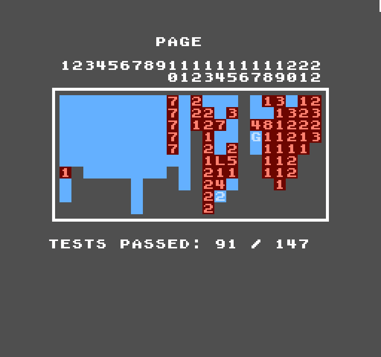

<p align="center">
  
</p>

<h1 align="center">InstantNES</h1>
<p align="center"><strong>A portable C11 Nintendo Entertainment System emulator for Linux.</strong></p>
<p align="center">Version 0.1 · First public release · Ubuntu / Linux X11</p>

<p align="center"><strong>Created 100% using ChatGPT 6 Instant, under the direction of HodgkinsStudios.</strong></p>

InstantNES pairs a reusable portable C11 emulation core with a lightweight native X11 desktop frontend. This is an experimental first release: accuracy and game compatibility are still being improved.

## Features

- **Portable C11 core:** CPU, PPU, APU, cartridge mapper support, and a reusable shared-library interface (`libinstantnes.so`).
- **ROM loading:** iNES and NES 2.0 formats for supported cartridges.
- **Desktop frontend:** Native X11 menus, ROM selection, reset, audio, and keyboard/gamepad input with configurable bindings.
- **Display modes:** Windowed and aspect-ratio-preserving Fullscreen. Press **Esc** to toggle.
- **Save states:** Five selectable save-state slots.
- **Presentation:** Offscreen UI composition and optimized software rendering.

## AccuracyCoin results

<p align="center">
  
</p>

<p align="center"><strong>91 / 147 passed · 61.9% · 56 not passing</strong></p>

The screenshot shows the completed AccuracyCoin test run against the release core. Testing used a headless harness; the ROM and harness are not distributed with this repository. This result is a test-suite baseline, **not** a guarantee of game compatibility or hardware-level accuracy.

## Build on Ubuntu

**Requirements:** C11 compiler, CMake, X11 development headers, and an X11 desktop session (or compatible X server).

```bash
sudo apt update
sudo apt install build-essential cmake libx11-dev zenity
cmake -S . -B build -DCMAKE_BUILD_TYPE=Release
cmake --build build -j"$(nproc)"
./build/instantnes
```

For a core-only build:

```bash
cmake -S . -B build-core -DIN_BUILD_FRONTEND=OFF -DCMAKE_BUILD_TYPE=Release
cmake --build build-core -j"$(nproc)"
```

## Controls

| Action | Default keyboard input |
| --- | --- |
| D-pad | Arrow keys |
| A / B | X / Z |
| Start / Select | Enter / Left Shift |
| Windowed ↔ Fullscreen | Esc |

Open a ROM with **File → Open NES ROM**. Change bindings through **Config → Input**; configuration is stored under `~/.local/share/InstantNES/` by default. Use **System → Save State Slot** to select a slot, then **Save State** or **Load State**.

## Repository structure

```text
InstantNES/
├── .github/workflows/   # Linux build workflow
├── include/             # Public emulator API
├── src/core/            # Portable C11 emulation core
├── src/frontend/        # X11 frontend and audio
├── screenshots/         # Project logo, icon, and AccuracyCoin result
├── CMakeLists.txt
├── LICENSE
└── README.md
```

## Known limitations

InstantNES is experimental. Some CPU/PPU/APU behaviors, cartridge configurations, and mapper features may be incomplete or inaccurate; not all games will work. Performance and fullscreen presentation can vary with the Linux desktop and graphics driver. The frontend targets X11; there is no GTK3 frontend or stretched fullscreen mode.

## Development, credits, and license

**InstantNES was created 100% using ChatGPT 6 Instant, under the direction of HodgkinsStudios.** This describes the project's stated development process; it is not an independent code-quality or accuracy certification.

Released under the [MIT License](LICENSE). No commercial game ROMs or BIOS files are included. InstantNES is an independent project and is not affiliated with or endorsed by Nintendo.
